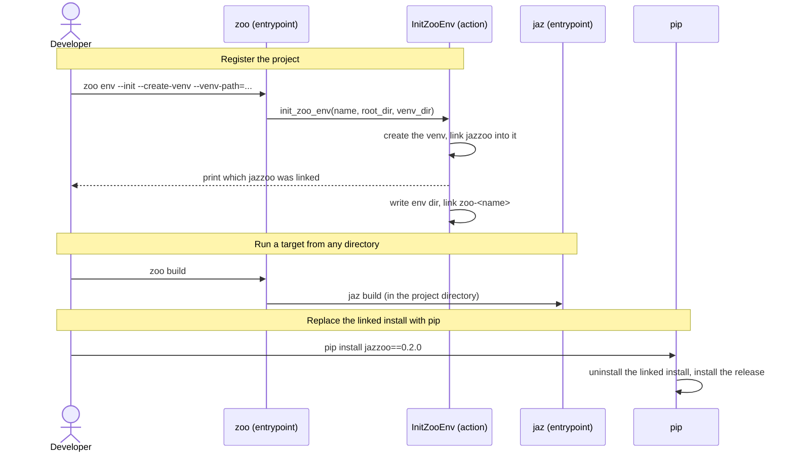

[comment]: <> (This file is auto-generated. Do not edit directly.)

# s10_a_developer_registers_a_project

## A developer registers a project

The developer registers a project directory with a root jazzoo file as a zoo
environment, with a new venv or an existing one. When the venv is activated, then `zoo` will always
run `jaz` relative to the project directory. Moreover, `zoo-<name>` will run jaz from the
`<name>` project directory regardless of which venv is active.

### Steps

#### It registers the project

In the project directory, the developer runs `zoo env --init --create-venv --venv-path=/path/to/venv`. 
This command makes a linked install of jazzoo in the indicated venv.
The command prints which jazzoo it linked into the venv, because a developer
may not expect it. 

#### It runs a target from any directory

`zoo` takes the options of `jaz`, except `--file`: it always runs the root jazzoo
file of the env. 

#### It replaces the linked install with pip

The developer runs `pip install jazzoo==0.2.0`. 
pip uninstalls the linked install as an editable install, without touching the linked directory, and installs the
release into the venv. 

### Diagram

