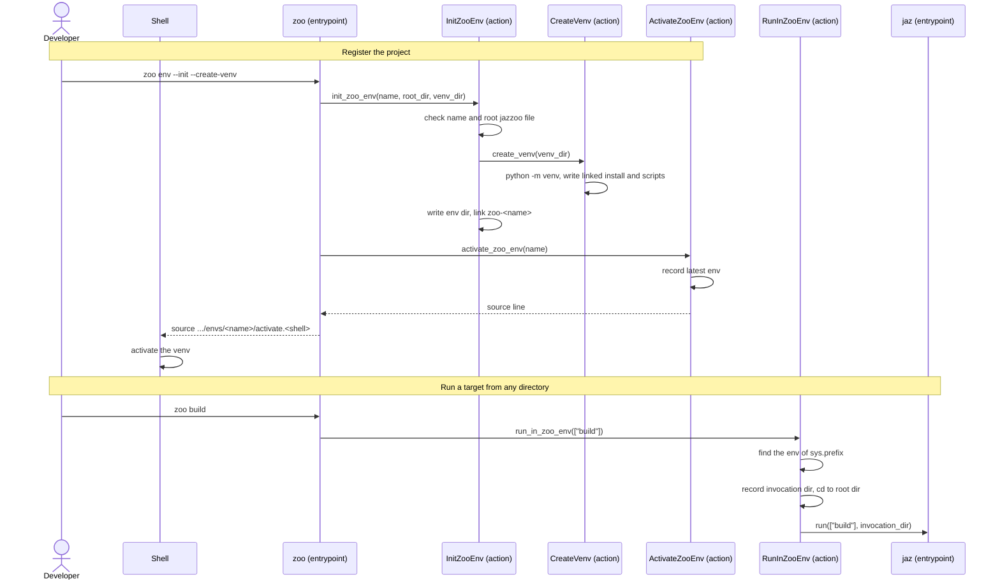

[comment]: <> (This file is auto-generated. Do not edit directly.)

# s10_a_developer_registers_a_project

## A developer registers a project

The developer registers a project directory with a root jazzoo file as a zoo
environment, with a new venv. From then on, the `zoo` of that venv runs the targets
of the project from any directory, and so does the link `zoo-<name>` in
`~/.local/bin`, whether or not the env is active.

### Steps

#### It registers the project

In the project directory, the developer runs
`eval "$(zoo env --init --create-venv)"`. 
`init_zoo_env` checks the name (by default the name of the directory) and that the
directory has a root jazzoo file. 
`create_venv` creates `.venv` in the project directory, and makes a linked install
of the jazzoo package that runs `zoo`, as `pip install -e` does: an import hook that
finds the package in its own directory, and package metadata that pip reads. The
version in the metadata comes from `get_jazzoo_version`. `create_venv` also writes the
`zoo`, `jaz`, `jazzoo` and `jaz-run` scripts into the `bin` directory of the venv. 
`init_zoo_env` writes the env directory in `~/.config/jazzoo/envs/<name>`: links to the
root directory and the venv, and an activate script per shell. It also links
`~/.local/bin/zoo-<name>` to the `zoo` of the venv. 
`activate_zoo_env` records the env as the latest one, and returns the line that sources
its activate script. `zoo` prints this line, and the shell sources it, which activates
the venv. 

#### It runs a target from any directory

The developer runs `zoo <target>` in any directory. With the venv active, this is the
`zoo` of the venv. 
`run_in_zoo_env` finds the env whose venv is the venv that `zoo` runs in
(`sys.prefix`). 
It records the current directory as `⚙️.invocation_dir`, changes to the root
directory of the env, and runs `jaz` in-process with the same arguments. 

### Diagram

