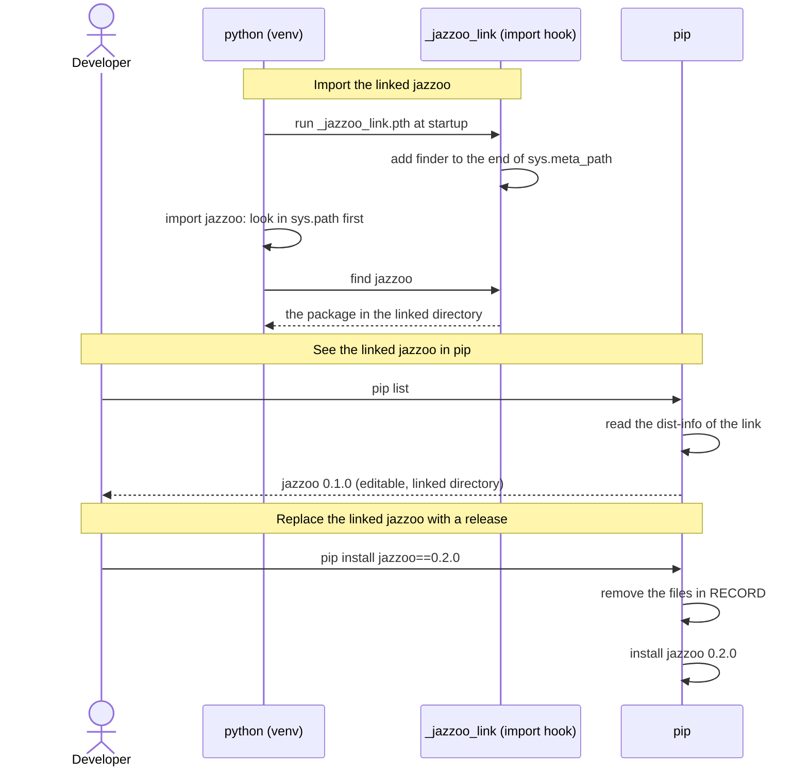

[comment]: <> (This file is auto-generated. Do not edit directly.)

# s15_a_developer_replaces_the_linked_jazzoo_with_pip

## A developer replaces the linked jazzoo with pip

A venv that `zoo env --init --create-venv` creates uses the jazzoo that runs `zoo`
(e.g. a development checkout) without copying it. pip sees this linked jazzoo as an
editable install, so the developer can replace it, or remove it, with pip, and pip
never touches the linked directory.

### Steps

#### It imports the linked jazzoo

When the python of the venv starts, it runs `_jazzoo_link.pth` in its site-packages,
which adds the import hook of `_jazzoo_link.py` to the end of `sys.meta_path`. 
On `import jazzoo`, python first looks in `sys.path`, so a real install of jazzoo in
the venv wins. Otherwise the hook finds the package in the linked directory. The hook
only answers for `jazzoo`: the other packages next to the linked directory stay
out of the venv. 

#### It shows the linked jazzoo in pip

The developer runs `pip list`. 
pip reads the dist-info that `create_venv` wrote, and shows jazzoo with the version of
the linked jazzoo, and the linked directory as its location:
`jazzoo  0.1.0  /home/me/projects/jazzoo/src/src/jazzoo`. 

#### It replaces the linked jazzoo with a release

The developer runs `pip install jazzoo==0.2.0`. 
pip uninstalls the linked jazzoo by removing the files in its `RECORD`: the
`_jazzoo_link` files, the dist-info and the console scripts. These are only the files
that `create_venv` wrote, so the linked directory is not touched. Then pip installs the
release. `pip uninstall jazzoo` removes the link in the same way. 
To replace the link with a release of the same version, the developer adds
`--force-reinstall`: otherwise pip sees that version installed. 

### Diagram

