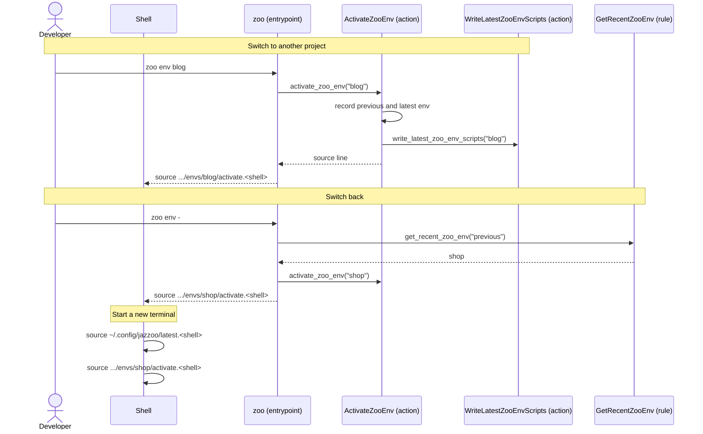

[comment]: <> (This file is auto-generated. Do not edit directly.)

# s20_a_developer_switches_between_projects

## A developer switches between projects

The developer works on several registered projects, and switches between them in the
same terminal. Like `cd -`, `zoo env -` goes back to the previous env. A new terminal
starts in the env that was activated last.

### Steps

#### It switches to another project

The developer runs `eval "$(zoo env blog)"` (in fish: `zoo env blog | source`). 
`activate_zoo_env` records the latest env as the previous one, and `blog` as the latest
one, in `~/.config/jazzoo/recent.json`. 
It calls `write_latest_zoo_env_scripts`, which rewrites `latest.bash` and
`latest.fish` in `~/.config/jazzoo` to source the activate scripts of `blog`. 
`zoo` prints the line that sources the activate script of `blog`. The shell sources
it, which deactivates the active venv and activates the venv of `blog`. 

#### It switches back

The developer runs `eval "$(zoo env -)"`. 
`get_recent_zoo_env` returns the previous env, which `activate_zoo_env` activates as
before. Running `zoo env -` again goes back and forth between the two envs. 

#### It starts a new terminal in the latest project

The startup file of the shell sources `~/.config/jazzoo/latest.<shell>`. In fish, this
is `conf.d/zoo.fish`, which `zoo env --install-fish` writes, and which only does this in
an interactive shell. In bash, the developer adds the line to `.bashrc`. 
This script sources the activate script of the latest env, so the new terminal starts
with its venv active. No Python runs, and no `zoo` is needed on the `PATH`. 

### Diagram

