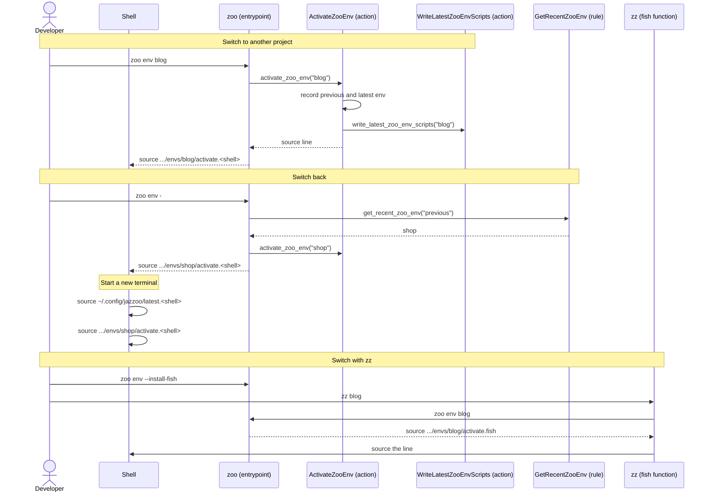

[comment]: <> (This file is auto-generated. Do not edit directly.)

# s20_a_developer_switches_between_projects

## A developer switches between projects

The developer works on several registered projects, and switches between them in the
same terminal. Like `cd -`, `zoo env -` goes back to the previous env. A new terminal
starts in the env that was activated last.

### Steps

#### It switches to another project

The developer runs `zoo env blog | source`. 
`activate_zoo_env` tracks the latest use zoo env (so that we can activate it when opening a new shell). 

#### It switches back

The developer runs `zoo env - | source`. 
`get_recent_zoo_env` returns the previous env, which `activate_zoo_env` activates as
before. Running `zoo env -` again goes back and forth between the two envs. 

#### It starts a new terminal in the latest project

The startup file of the shell sources `~/.config/jazzoo/latest.<shell>`. 
This script sources the activate script of the latest env, so the new terminal starts
with its venv active. No Python runs, and no `zoo` is needed on the `PATH`. 

#### It switches with zz

The developer runs `zoo env --install-fish` once, which installs the `zz` function and the
completions of `zz`, `jaz` and `zoo` in the fish config directory. 
`zz blog` runs `zoo env blog` and sources the line that it prints, so `zz -` and `zz --list`
work as their `zoo env` counterparts. Pressing tab after `zz` completes the names of the envs. 

### Diagram

