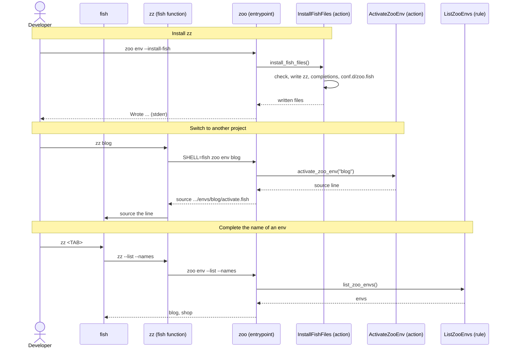

[comment]: <> (This file is auto-generated. Do not edit directly.)

# s25_a_developer_switches_projects_with_zz

## A developer switches projects with zz

A program cannot change the shell that runs it, so `zoo env` only prints the line that
activates an env, and the shell sources it. In fish, the developer installs the `zz`
function once, which sources the line itself: `zz blog` switches to blog, `zz -` goes
back, and `zz` alone lists the envs. In bash, the developer defines it in `.bashrc`:
`zz() { eval "$(zoo env "$@")"; }`.

### Steps

#### It installs zz

The developer runs `zoo env --install-fish`. 
`install_fish_files` writes these files to the fish config directory
(`$XDG_CONFIG_HOME/fish`, or `~/.config/fish`): the `zz` function in `functions/`, the
completions of `zz`, `jaz`, `jazzoo` and `zoo` in `completions/`, and
`conf.d/zoo.fish`, which makes a new interactive fish start in the latest env. 
The completions of `jaz`, `jazzoo` and `zoo` pass the command line to
`<command> --complete`, which prints the candidates. It reads the jazzoo file without
running its top-level statements, so that pressing tab has no side effects. 
Each file starts with `# managed by zoo env --install-fish`. A file with this line is
overwritten, so running the installer again updates the files. When a file of the
developer is in the way, it raises a `FishFileExistsError` that lists such files, and
writes nothing. 
`zoo` prints the files that it wrote to stderr: its stdout is for lines to source. 

#### It switches to another project

The developer runs `zz blog`. 
`zz` runs the `zoo` of the active env, or, when no env is active, the `zoo-<name>` link
of any registered env: every `zoo` can switch to every env. 
It runs `zoo env blog` with `SHELL` set to `fish`, because `zoo` picks the activate
script from `SHELL`, which is the login shell. `activate_zoo_env` activates blog, and
`zoo` prints the line that sources its fish activate script. 
`zz` sources the line, which activates the venv of blog. When `zoo env` fails, it
sources nothing. With `--list` or `--forget`, which activate nothing, `zz` only runs
`zoo env`. 

#### It completes the name of an env

The developer types `zz` and presses tab. 
The completions run `zz --list --names`, which prints the names of the registered envs,
one per line. Fish offers these names and `-`. 

### Diagram

