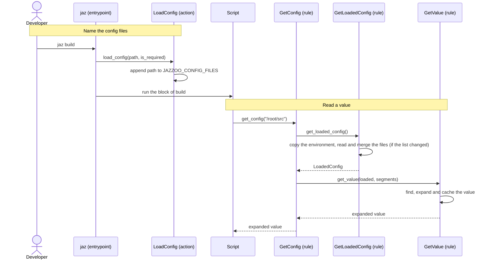

[comment]: <> (This file is auto-generated. Do not edit directly.)

# s30_a_script_reads_config_values

## A script reads config values

A jazzoo file names the YAML config files of a project, and a script that it runs
(a Python shebang block, or any `python foo.py` shell line) reads values from the
merged config with `get_config`. Jazzoo only manages the list of config files; it
never reads them itself.

```
⚙️.load_config(path=⚙️.module.dirname / "config/base.yaml")
⚙️.load_config(path=⚙️.module.dirname / "config/local.yaml", required=false)

build:
    #!/usr/bin/env python3
    from jazzoo import get_config as get

    print(f"building {get('/root/src')}")
```

```yaml
# config/base.yaml
root:
  project_dir: ${PROJECT_DIR}
  src: ${/root/project_dir}/src
```

`get_config`, `prepare_config` and the config errors live in the self-contained
sub-package `jazzoo.config`, which imports only the standard library (and a vendored
copy of PyYAML). A project can copy it into its own source tree, and its
`get_config` reads the same list of config files that `jaz` sets.

### Steps

#### It names the config files

The developer runs a target with `jaz`.</br>
Each `⚙️.load_config` in the jazzoo file calls `load_config`, which checks that the
file exists (a missing file is skipped when it is not required), and appends its
absolute path to the environment variable `JAZZOO_CONFIG_FILES`.</br>
The script of the target inherits this variable.</br>

#### It reads a value

The script calls `get_config` with a path into the config, such as `/root/src`, and
optionally a default for a path that does not exist.</br>
`get_loaded_config` returns the cached `LoadedConfig`. When the value of
`JAZZOO_CONFIG_FILES` differs from the one that the cache was built from, it builds a
new one: it copies the environment, `read_config_layers` reads each file as plain
YAML, together with the layers that the file includes, and `merge_config` merges them
in list order (a later file overrides an earlier one, recursively for dicts).</br>
`get_value` finds the value at the path in the merged tree, and expands it lazily:
`${/a/b}` is replaced by another config value, `${NAME}` by a variable of the copied
environment, and references may be nested and chained. Only the value at the path
and what it references are expanded, and each expanded value is cached.</br>
`get_config` returns the expanded value.</br>

A script that changes its own environment first calls `prepare_config`, which builds
the `LoadedConfig` without expanding anything, so that every `get_config` sees the
environment as it was when the script started.</br>

### Diagram



