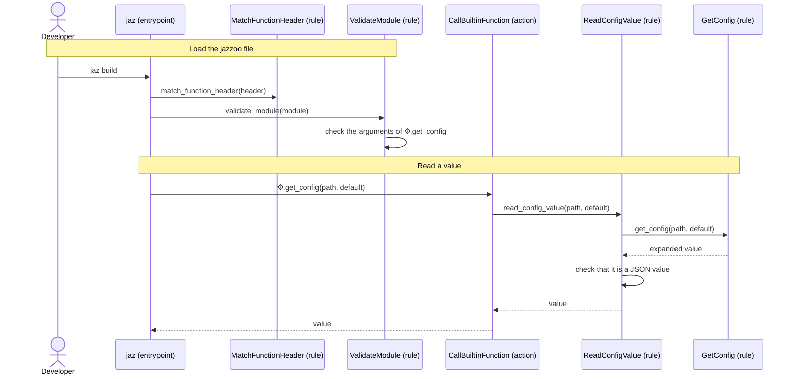

[comment]: <> (This file is auto-generated. Do not edit directly.)

# s32_a_jazzoo_file_reads_config_values

## A jazzoo file reads config values

A jazzoo file reads a value of the merged config with `⚙️.get_config`. It returns
what `get_config` returns in a script, as a jazzoo value, so that a target can use
config values without running a script. A typical use is a parameter default that
comes from the config:

```
⚙️.load_config(path=⚙️.module.dirname / "config/base.yaml")
⚙️.load_config(path=⚙️.module.dirname / "config/local.yaml", required=false)

build(local=⚙️.get_config(path="/compose/use_dockerfile_local", default=false)):
    🐆.local-flag = "--local" if 🐆.local else ""
    ⚙️.python build.py 🐆.local-flag

deploy():
    echo "deploying to {{ ⚙️.get_config(path="/deploy/host") }}"
```

### Steps

#### It loads the jazzoo file

The developer runs a target with `jaz`.</br>
`match_function_header` reads each function header. A parameter default is an
expression, so it may be a call with its own parentheses; the closing parenthesis
of the header is found by counting, and a parenthesis inside a string is part of
the string.</br>
`validate_module` checks the arguments of each `⚙️.get_config` call (`path`, and
optionally `default`), also in a parameter default and in `{{ }}`. A wrong call is
an `ArgumentError` when the module is loaded.</br>

#### It reads a value

A parameter default is evaluated on every call that omits the argument, so `build`
reads the config when it is called, and `build(local=true)` does not read it.</br>
`call_builtin_function` calls `read_config_value`, which calls `get_config` with the
path, and the default if the call has one. `get_config` reads the config list as it
is at that moment: a top-level assignment does not see a config file that a later
`⚙️.load_config` adds. The YAML is parsed when a value is first read, and cached until
the list changes, so a run that does not read the config does not parse it.</br>
A dict becomes an object and a list an array. A value that is not a JSON value
(e.g. a YAML date) is an `ExecutionError`, and so is every error of `get_config`
(e.g. a missing path without a default).</br>

### Diagram



