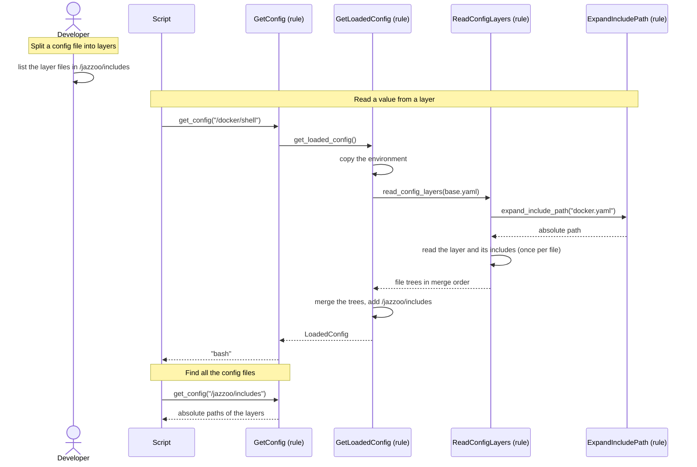

[comment]: <> (This file is auto-generated. Do not edit directly.)

# s35_a_config_file_includes_layers

## A config file includes layers

A config file can pull in other config files, its layers, with `/jazzoo/includes`.
The layers are logically part of the file, so the jazzoo file only loads the file
itself, and a script reads the values of its layers as if they were in the file.

```yaml
# env/local/config/base.yaml
jazzoo:
  includes:
    - tmux.yaml
    - docker.yaml

docker:
  shell: bash
```

```yaml
# env/local/config/docker.yaml
jazzoo:
  includes:
    - common.yaml

docker:
  compose_project: blogs
  shell: sh
```

The includes are resolved by `get_config`, when it reads the files; `jaz` never reads
them. The whole `/jazzoo` subtree of the config is reserved for Jazzoo.

### Steps

#### It splits a config file into layers

The developer moves parts of a config file into layer files, and lists them in the
`/jazzoo/includes` of the file. An include is a path relative to the file that
contains it (or absolute), and may use environment variables (`${NAME}`,
`${NAME:-default}`) and a leading `~`. It cannot reference a config value, because
the config is not built yet. A layer may include layers of its own.</br>

#### It reads a value from a layer

The script calls `get_config`, and `get_loaded_config` builds the `LoadedConfig`. It
first copies the environment, which include paths and values both read.</br>
For each file in `JAZZOO_CONFIG_FILES`, `read_config_layers` reads the file with
`read_config_file`, and takes the includes out of its tree. `expand_include_path`
turns each include into an absolute path, and `read_config_layers` reads that layer
in the same way, depth-first.</br>
Every file is read once in the whole config list, at its first position: a file
that was read already (a cycle, a layer that two files include, or a file in the
list that an earlier file included) is skipped.</br>
`read_config_layers` returns the files in merge order: the layers of a file come
before the file, a layer's own includes before the layer. So a file wins over its
layers. `merge_config` merges all the files in this order.</br>
`get_config` reads the value from the merged tree as usual. An error about a value
names the layer that supplied it.</br>

#### It finds all the config files of a project

The expanded includes list is added to the merged tree at `/jazzoo/includes`: the
absolute paths of the layers of all the files in `JAZZOO_CONFIG_FILES`, in merge
order. A tool that opens or lists the config files of a project (e.g. an
`edit-config` target) reads it with `get_config`.</br>

### Diagram



