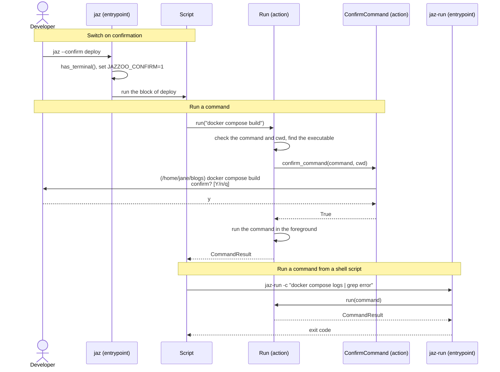

[comment]: <> (This file is auto-generated. Do not edit directly.)

# s40_a_script_runs_commands_with_confirmation

## A script runs commands with confirmation

A script (that is triggered by jazzoo) can use the run function to run commands. With
`jaz --confirm`, the developer is asked before each of these commands, and can run it,
skip it or abort. The shell lines and shebang blocks of the jazzoo file itself are never
confirmed.

### Steps

#### It switches on confirmation

The developer runs `jaz --confirm <target>`. 
`jaz` calls `has_terminal`, and fails when there is no terminal to ask on. It sets
`JAZZOO_CONFIRM=1` in its environment, which every script of the run (and of a
nested `jaz`) inherits, and runs the target. 

#### It runs a command

The script calls `run` with a command. 
When `is_confirm_on` finds `JAZZOO_CONFIRM=1`, `confirm_command` shows the command
with its directory on the terminal, and reads the answer. On `y`, `run` runs the
command; on `n`, it skips the command and returns a `CommandResult` with `skipped=True`;
on `q`, `confirm_command` raises `CommandAbortedError`, so `jaz` stops the run. 

#### It runs a command from a shell script

A shell script, or a shell line of a jazzoo file, runs `jaz-run <executable> [<argument> ...]`,
or `jaz-run -c "<command>"` for a command that runs in bash. 
`jaz-run` calls `run` with the command, so the command is confirmed in the same way, and exits
with the exit code of the command (`0` when the developer skipped it, `130` when they
aborted). 

### Diagram

