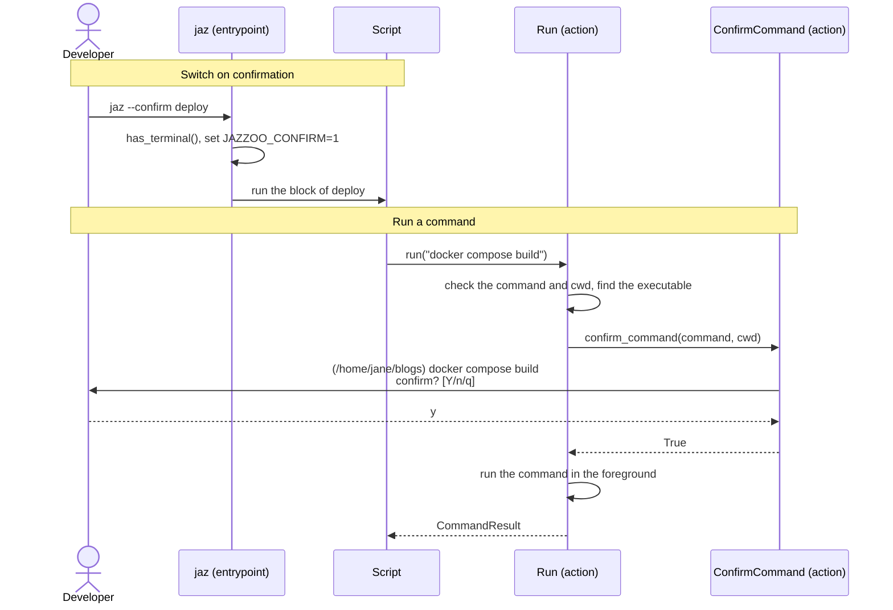

[comment]: <> (This file is auto-generated. Do not edit directly.)

# s40_a_script_runs_commands_with_confirmation

## A script runs commands with confirmation

A script that a jazzoo file runs (a Python shebang block, or any `python foo.py`
shell line) runs commands with `run`. With `jaz --confirm`, the developer is asked
before each of these commands, and can run it, skip it or abort. The shell lines and
shebang blocks of the jazzoo file itself are never confirmed.

```python
from jazzoo import run

run("docker compose logs | grep error")                 # a string runs in bash
run(["tmux", "send-keys", "-t", pane, command, "C-m"])  # a list runs directly
head = run("git rev-parse HEAD", capture=True).stdout
```

`run`, `CommandResult` and the command errors live in the self-contained sub-package
`jazzoo.commands`, which a project can copy into its own source tree.

### Steps

#### It switches on confirmation

The developer runs `jaz --confirm <target>`.</br>
`jaz` calls `has_terminal`, and fails when there is no terminal to ask on. It sets
`JAZZOO_CONFIRM=1` in its environment, which every script of the run (and of a
nested `jaz`) inherits, and runs the target.</br>

#### It runs a command

The script calls `run` with a command, and optionally `cwd`, `env`, `capture`,
`check` and `echo`.</br>
`run` checks the command and `cwd` before anything runs. A string command runs in
bash; for a list command, `find_executable` looks up the executable on the `PATH` of
the command's environment.</br>
When `is_confirm_on` finds `JAZZOO_CONFIRM=1`, `confirm_command` shows the command
with its directory on the terminal (`/dev/tty`), and reads the answer from it. On
`n`, `run` skips the command and returns a `CommandResult` with `skipped=True`; on
`q`, `confirm_command` raises `CommandAbortedError`, so the script fails and `jaz`
stops the run.</br>
`run` runs the command in the foreground (or captures its output with
`capture=True`), while a ctrl-c reaches the command only.</br>
It returns a `CommandResult`, or raises `CommandFailedError` when the command exits
non-zero and `check` is true.</br>

### Diagram



