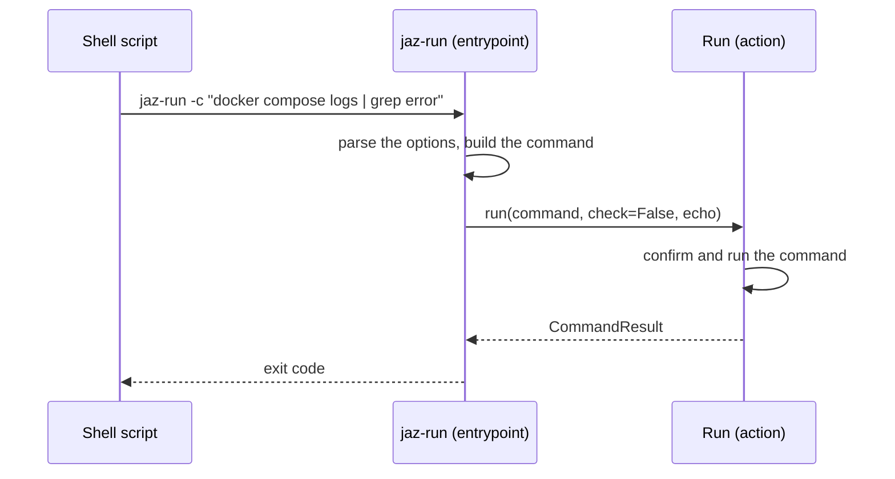

[comment]: <> (This file is auto-generated. Do not edit directly.)

# s50_a_shell_script_runs_commands_with_jaz_run

## A shell script runs commands with jaz-run

`jaz-run` is the command-line front-end of `run`, for shell scripts and the shell
lines of jazzoo files. Its commands are confirmed, echoed and prompted for as those
of `run`, so a shell script can take part in `jaz --confirm`.

```
deploy():
    jaz-run docker compose down -v --project=🐆.name
    jaz-run -c "docker compose logs | grep error"
```

`jaz-run` is installed as a console script next to `jaz`. Its entrypoint lives in the
`jazzoo.commands` sub-package, which also has a `__main__.py`, so that a copy of the
sub-package runs it with `python3 -m <package> ...`.

### Steps

#### It runs a command

The shell script runs `jaz-run [--echo] [--] <executable> [<argument> ...]`, or
`jaz-run [--echo] -c "<command>"`.</br>
`jaz-run` reads its own options up to the first argument that is not one of them;
everything after it belongs to the command. Invalid arguments are a
`UsageError`.</br>
Without `-c`, the arguments are a list command; with `-c`, the single argument
after it is a string command, which runs in bash.</br>
It calls `run` with the command, `check=False` and the `echo` of `--echo`. The
command runs in the current directory and environment of the shell.</br>
It exits with the exit code of the command, `0` when the developer skipped it,
`130` when they aborted, `127` when the executable is not found, and `2` on any other
error. Its messages on stderr start with `jaz-run: `.</br>

### Diagram



