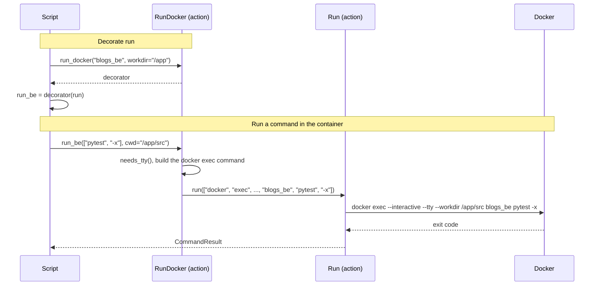

[comment]: <> (This file is auto-generated. Do not edit directly.)

# s60_a_script_runs_commands_in_a_container

## A script runs commands in a container

A script decorates `run` with `run_docker`, so that its commands run in a Docker
container that is already running, with `docker exec`. The undecorated `run` still
runs commands on the host.

```python
from jazzoo import get_config as get, run, run_docker

run_be = run_docker(get("/blogs_be/container"), workdir="/app")(run)

run_be("python manage.py migrate")
run_be(["pytest", "-x"], cwd="/app/src")
run("docker compose ps")
```

The decorated function only rewrites the command, and passes it to the function that
it decorates. Echo, confirmation, `capture`, `check` and the `CommandResult` are
therefore those of `run`, and they all show the full `docker exec` command.

### Steps

#### It decorates run

The script calls `run_docker` with the container, and optionally the `user`,
`workdir`, `env` and `shell` that hold for every command.</br>
`run_docker` returns a decorator, which the script applies to `run` (or to any
function with the signature of `run`).</br>

#### It runs a command in the container

The script calls the decorated function as it would call `run`.</br>
A string command becomes a list that runs it in the shell of the container (`bash -c`
by default).</br>
`needs_tty` decides whether to pass `--tty`: only when the output is not captured and
the script runs in a terminal.</br>
The `cwd` of the call is a directory in the container, and replaces the `workdir`; the
`env` of the call is merged over that of `run_docker`. Both become options of
`docker exec`.</br>
It calls `run` with the `docker exec` command, so the command runs in the foreground
in the container, and `run` returns the `CommandResult`.</br>

### Diagram



