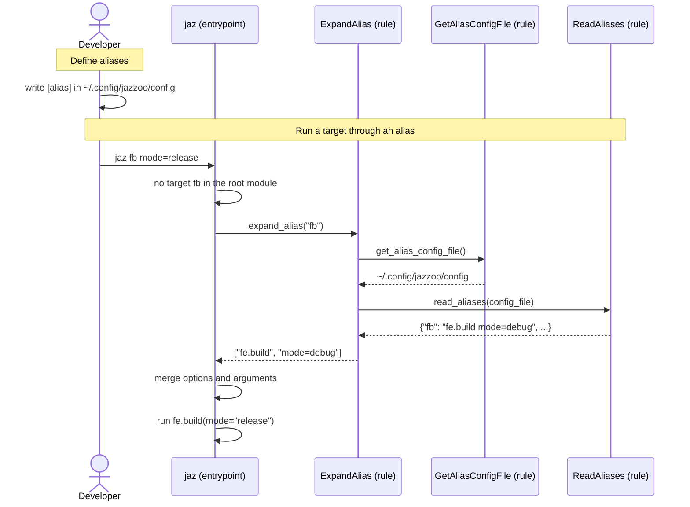

[comment]: <> (This file is auto-generated. Do not edit directly.)

# s70_a_developer_runs_a_target_through_an_alias

## A developer runs a target through an alias

The developer gives short names to the targets that they run often. The aliases are
personal: they live in the developer's config directory, and apply to every Jazzoo
file that the developer runs, as the aliases of git do.

### Steps

#### It defines aliases

The developer writes an `[alias]` section in `~/.config/jazzoo/config` (or in
`$XDG_CONFIG_HOME/jazzoo/config`), which is an INI file:</br>

```ini
[alias]
b = build
fb = fe.build mode=debug
dep = deploy --confirm
```

An expansion is a target, followed by arguments and options of `jaz`, as on the
command line.</br>

### Diagram



