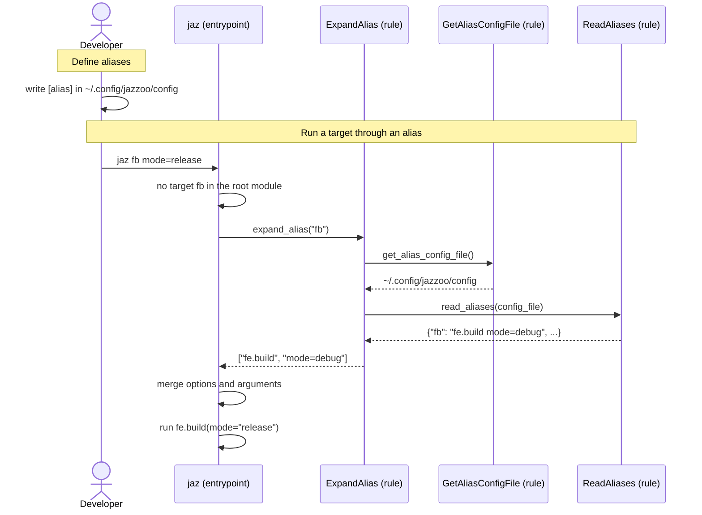

[comment]: <> (This file is auto-generated. Do not edit directly.)

# s70_a_developer_runs_a_target_through_an_alias

## A developer runs a target through an alias

The developer gives short names to the targets that they run often. The aliases are
personal: they live in the developer's config directory, and apply to every Jazzoo
file that the developer runs, as the aliases of git do.

### Steps

#### It defines aliases

The developer writes an `[alias]` section in `~/.config/jazzoo/config` (or in
`$XDG_CONFIG_HOME/jazzoo/config`), which is an INI file:</br>

```ini
[alias]
b = build
fb = fe.build mode=debug
dep = deploy --confirm
```

An expansion is a target, followed by arguments and options of `jaz`, as on the
command line.</br>

#### It runs a target through an alias

The developer runs `jaz fb mode=release`.</br>
`jaz` looks up `fb` as a target of the root module. Only when there is no such target,
it calls `expand_alias`, so an alias never changes what an existing target does.</br>
`expand_alias` reads the aliases of the config file with `read_aliases`, and returns
the expansion of `fb` split into tokens. A config file that does not exist has no
aliases; an invalid config file or expansion raises an `AliasError`.</br>
`jaz` adds the options of the expansion (`--confirm`, `--trace`) to those of the
command line. The arguments of the expansion are presets: an argument on the command
line overrides the one of the expansion for the same parameter. So `jaz fb
mode=release` runs `fe.build` with `mode=release`.</br>
The target of an expansion must be a real target: aliases are not chained.</br>

### Diagram



